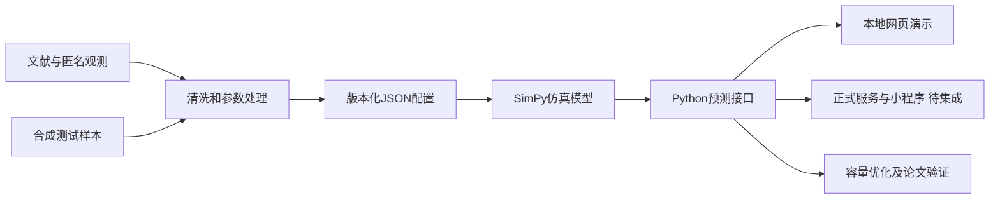

# 总体架构与模块接口

## 处理流程



## 模块边界

| 模块 | 输入 | 输出与对接 |
| --- | --- | --- |
| 采集 | 文献、问卷及实地观测 | 匿名字段表、来源和采集条件 |
| 参数 | 原始记录与字段字典 | 分情境的多日到达轨迹及延迟样本池 |
| 仿真 | 柜体配置、到达轨迹、样本池、种子 | 逐订单时刻、队列与柜位轨迹 |
| 预测 | 配置、种子、重复次数 | 等待分布与时间加权占用指标 |
| 展示 | 运行条件与预测输出 | 条件选择、曲线、来源标签和导出 |
| 优化及研究 | 候选配置、成本约束、真实验证数据 | 方案比较、验证统计和研究结论 |

## 已有开发接口

以下实现位于zpx/model-development，而不是main：

```python
from locker_model import predict, simulate, compare_capacities
from locker_model.adapters import JsonParameterProvider

config = JsonParameterProvider('examples/registry.json').get_config('weekday_clear_lunch_normal')
summary = predict(config, seed=42, replications=20)
trace = simulate(config, seed=42)
variants = compare_capacities(config, [8, 16, 24], seed=42, replications=20)
```

输入协议schema_version为1.0；参数必须含source_kind和provenance。缺失情境显式报错。完整协议见 [开发分支接口文档](https://github.com/changeable100/waiting_issue/blob/zpx/model-development/docs/02_contract.md)。

本地原型已有GET /api/scenarios与POST /api/simulate，只监听127.0.0.1；正式Flask服务、鉴权、部署与微信小程序由系统模块继续完成。不要把本地演示接口当作正式线上服务。HTTP适配与模型解耦，迁移时保留输入输出含义及来源信息。
